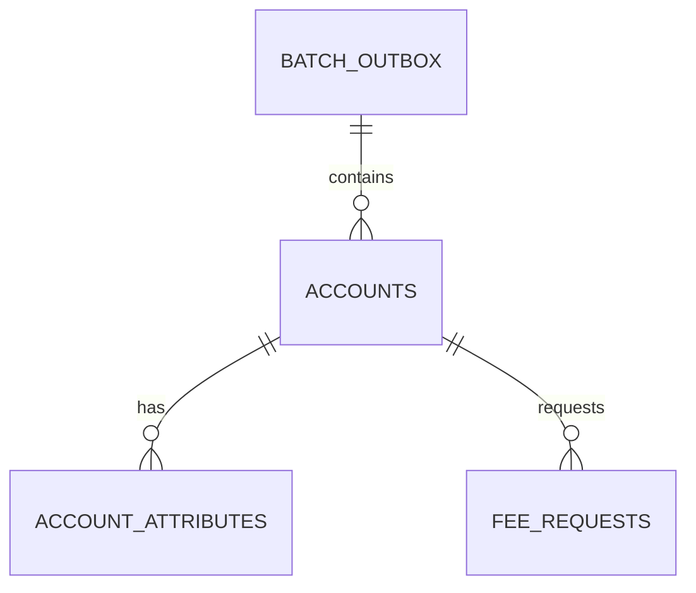

# Account Store Database Schema

This document describes the final **Account Store** relational schema produced by the Pricing Engine's Flyway migrations:

- `pricing-engine/src/main/resources/db/account` (V1-V2);
- `pricing-engine/src/main/resources/db/account-postgresql` (PostgreSQL-only V3 and repeatable access grants).

The Account Store is a separate PostgreSQL database (default: `accountdb`). The Mock Account Processor inserts submitted batches, and the Pricing Engine reads them and updates batch processing state. The Pricing Engine owns database initialization and migrations when `database-initialization.enabled=true`; the Mock Server has Flyway disabled and validates the existing schema with Hibernate.

The PostgreSQL-only triggers and grants below apply when the `db/account-postgresql` location is enabled. They are not part of the portable V1-V2 schema.

## Schema overview

The outbox is also the batch identity table: there is no separate `batches` table. Each batch contains accounts, and each account has attribute values and fee requests.

## Batch processing state

### `batch_outbox`

| Column | Type | Null | Rules |
|---|---|---:|---|
| `batch_id` | `uuid` | No | Primary key; submitted batch identifier |
| `processed` | `boolean` | No | Defaults to `false` |
| `error` | `text` | Yes | Added in V2; no default |

- Exactly one outbox row can exist per `batch_id`.
- The outbox stores completion/error state, not wake-up delivery attempts or batch-level pricing dates.
- PostgreSQL V3 prevents deletion/truncation and changes to `batch_id`. Updates to `processed` and `error` remain permitted.

## Submitted account data

### `accounts`

| Column | Type | Null | Rules |
|---|---|---:|---|
| `id` | `bigint` identity | No | Primary key; generated by default |
| `batch_id` | `uuid` | No | Foreign key to `batch_outbox.batch_id` |
| `account_number` | `varchar(25)` | No | Unique within a batch |
| `product_code` | `varchar(25)` | No | |
| `branch_code` | `varchar(25)` | No | |
| `pricing_date` | `date` | No | Each account's pricing date |

- Foreign key: `fk_accounts_batch`.
- Unique constraint: `uk_accounts_batch_account_number` on (`batch_id`, `account_number`).
- The foreign key has no explicit `ON DELETE` action. The account rows are not order-preserving.

### `account_attributes`

| Column | Type | Null | Rules |
|---|---|---:|---|
| `id` | `bigint` identity | No | Primary key; generated by default |
| `account_id` | `bigint` | No | Foreign key to `accounts.id` |
| `code` | `varchar(25)` | No | Submitted attribute code |
| `value` | `jsonb` | No | JSON string, number, or boolean |

- Foreign key: `fk_account_attributes_account`; no explicit `ON DELETE` action.
- Check constraint `chk_account_attributes_scalar` requires `jsonb_typeof(value)` to be `string`, `number`, or `boolean`. SQL NULL and JSON null are rejected.
- **Current migration caveat:** The Mock Account Processor design specifies unique (`account_id`, `code`), but the actual V1-V2 migrations do **not** define that unique constraint. The database schema therefore does not enforce it.

### `fee_requests`

| Column | Type | Null | Rules |
|---|---|---:|---|
| `id` | `bigint` identity | No | Primary key; generated by default |
| `account_id` | `bigint` | No | Foreign key to `accounts.id` |
| `fee_request_id` | `bigint` | No | Submitted request identifier; unique within an account |
| `code` | `varchar(25)` | No | Fee code |
| `transaction_amount` | `numeric` | Yes | Nonnegative multiple of `0.01`, when provided |

- Foreign key: `fk_fee_requests_account`; no explicit `ON DELETE` action.
- Unique constraint: `uk_fee_requests_account_fee_request_id` on (`account_id`, `fee_request_id`).
- Check constraint: `chk_fee_requests_transaction_amount` requires `transaction_amount >= 0` and `mod(transaction_amount, 0.01) = 0`. A NULL amount passes the check.
- `fee_request_id` is not the table's primary key.

## Constraint and index summary

The migrations enforce:

- unique batch IDs, account numbers within each batch, and Fee Request IDs within each account;
- referential integrity from accounts to the batch outbox and from child records to accounts;
- scalar-only JSONB attribute values;
- nonnegative, cent-increment transaction amounts when present.

Primary keys and unique constraints create supporting indexes. No additional standalone indexes are declared by these migrations. **Attribute codes within one account have no database unique constraint**, despite the design document stating otherwise.

Foreign keys have no explicit delete behavior; PostgreSQL's default applies.

## PostgreSQL-only mutation protection

V3 installs `reject_store_mutation()` and `protect_outbox_batch_identity()` trigger functions:

| Table | Database-enforced protection |
|---|---|
| `accounts` | Reject statement-level UPDATE, DELETE, TRUNCATE |
| `account_attributes` | Reject statement-level UPDATE, DELETE, TRUNCATE |
| `fee_requests` | Reject statement-level UPDATE, DELETE, TRUNCATE |
| `batch_outbox` | Reject DELETE and TRUNCATE; reject updates changing `batch_id` |

This allows durable submitted data to remain unchanged while the Pricing Engine records processing state on the outbox.

## Database access grants

The repeatable PostgreSQL grant migration restricts access to two application logins:

| Role | Table privileges |
|---|---|
| Mock Server login | SELECT and INSERT on all four tables; USAGE/SELECT on sequences |
| Pricing Engine login | SELECT on all four tables; UPDATE on `batch_outbox` |

Both logins receive database CONNECT and schema USAGE. Initialization uses a separately configured account with privileges to create the database, roles, schema, and migrations. These grants are applied only when the PostgreSQL initialization path is enabled.

## Migration history affecting the final shape

| Migration | Final-schema effect |
|---|---|
| Account V1 | Creates `batch_outbox`, `accounts`, `account_attributes`, and `fee_requests` with primary keys, foreign keys, unique constraints, and checks. |
| Account V2 | Adds nullable `batch_outbox.error`. |
| PostgreSQL V3 | Adds immutable-data triggers, retains outbox rows, and protects batch identity. |
| Repeatable PostgreSQL grants | Grants producer read/insert and engine read/outbox-update permissions. |

This document describes **database-enforced** behavior, not all API validation or application-layer rules. The planned contract and persistence decisions are documented in [Mock Account Processor design](../mock-account-processor-design.md). The surrounding flow appears in [System Architecture](../system-architecture.md).
