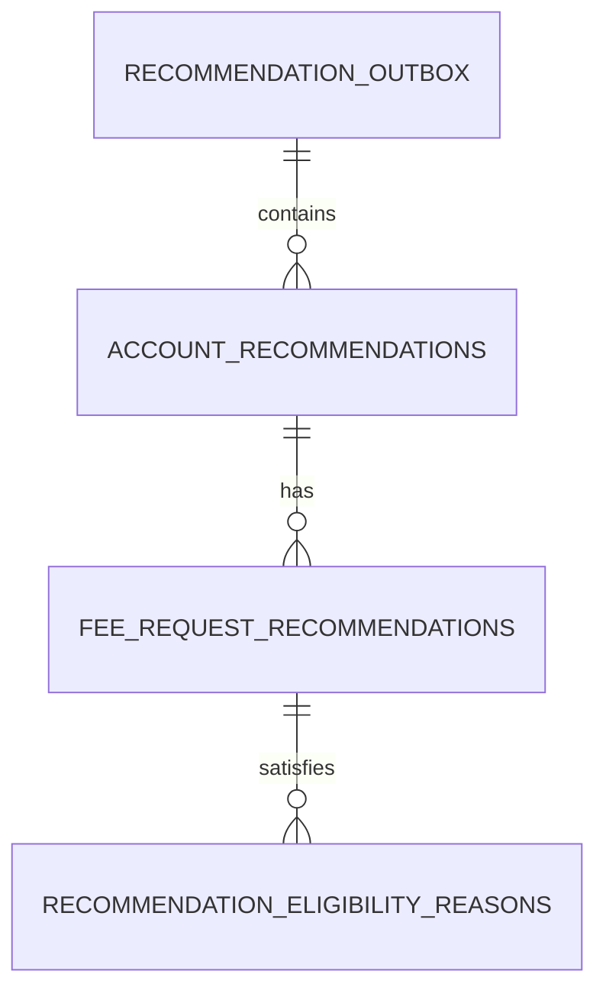

# Transaction Recommendation Store Database Schema

This document describes the final schema of the **Recommendation Store**—the transaction-side store in the pricing pipeline—produced by the Pricing Engine's Flyway migrations:

- `pricing-engine/src/main/resources/db/recommendation` (portable V1, V2, V5);
- `pricing-engine/src/main/resources/db/recommendation-postgresql` (PostgreSQL-only V3, V4, V6 and repeatable access grants).

The default database is `recommendationdb`, separate from the Pricing Store and Account Store. It contains **transaction recommendations produced by the Pricing Engine**, not a ledger of successfully posted transactions. The Mock Transaction Processor is the intended downstream reader.

The Pricing Engine always configures the portable recommendation migrations. When `database-initialization.enabled=true`, it also loads the PostgreSQL-specific location, including the triggers and grants described below.

## Schema overview

Each batch is represented by one `recommendation_outbox` row. That batch contains account outcomes, each account outcome can contain Fee Request recommendations, and each Fee Request recommendation can have satisfied Eligibility Reason codes.

## Recommendation batch processing state

### `recommendation_outbox`

| Column | Type | Null | Rules |
|---|---|---:|---|
| `batch_id` | `uuid` | No | Primary key; correlates to the source Account Store batch |
| `processed` | `boolean` | No | Defaults to `false` |

- There is one outbox row per `batch_id`. The database does not have a cross-database foreign key to the Account Store.
- The outbox tracks downstream processing completion, not notification-delivery attempts.
- PostgreSQL V3 prevents deletion/truncation and changes to `batch_id`, but allows the `processed` flag to be updated.

## Account-level outcomes

### `account_recommendations`

| Column | Type | Null | Rules |
|---|---|---:|---|
| `id` | `bigint` identity | No | Primary key; generated by default |
| `batch_id` | `uuid` | No | Foreign key to `recommendation_outbox.batch_id` |
| `account_number` | `varchar(25)` | No | Unique within a recommendation batch |
| `status` | `varchar(30)` | No | Account outcome status |
| `pricing_plan_code` | `varchar(25)` | Yes | Selected Pricing Plan, if any |

- Foreign key: `fk_account_recommendations_batch`.
- Unique constraint: `uk_account_recommendations_batch_account` on (`batch_id`, `account_number`).
- The foreign key has no explicit `ON DELETE` action.
- The database does not define a CHECK constraint enumerating allowed `status` values.

## Fee Request outcomes

### `fee_request_recommendations`

| Column | Type | Null | Rules |
|---|---|---:|---|
| `id` | `bigint` identity | No | Primary key; generated by default |
| `account_id` | `bigint` | No | Foreign key to `account_recommendations.id` |
| `fee_request_id` | `bigint` | No | Submitted Fee Request correlation ID |
| `status` | `varchar(35)` | No | `CHARGED`, `WAIVED`, or a Fee Request failure status |
| `amount` | `numeric` | Yes | Nonnegative calculated amount, when present |

- Foreign key: `fk_fee_recommendations_account`; no explicit `ON DELETE` action.
- Unique constraint: `uk_fee_recommendations_account_request` on (`account_id`, `fee_request_id`).
- Check constraint: `chk_fee_recommendations_amount` rejects negative non-null amounts. NULL is allowed.
- The engine stores `CHARGED` or `WAIVED` for successful Fee Requests, or a failure status such as `FEE_NOT_FOUND`. There is no separate `decision` column or status-value CHECK constraint.
- The amount has no declared precision or scale.
- `fee_request_id` is a correlation field, not the primary key.

### `recommendation_eligibility_reasons`

| Column | Type | Null | Rules |
|---|---|---:|---|
| `fee_recommendation_id` | `bigint` | No | Foreign key to `fee_request_recommendations.id` |
| `reason_code` | `varchar(25)` | No | Satisfied eligibility reason code |

- Composite primary key: (`fee_recommendation_id`, `reason_code`).
- Foreign key: `fk_recommendation_reasons_fee`; no explicit `ON DELETE` action.
- A Fee Request recommendation cannot record the same reason code twice.
- This table stores codes rather than foreign keys into Pricing Store eligibility definitions.

## Constraint and index summary

The migrations enforce:

- one recommendation outbox row per batch;
- unique Account Numbers within each recommendation batch;
- unique Fee Request IDs within each account recommendation;
- unique satisfied Reason Codes within each Fee Request recommendation;
- foreign keys along the outbox → account → Fee Request → reason chain;
- nonnegative Fee Request amounts when present.

Primary keys and unique constraints create supporting indexes. No additional standalone indexes are declared by these migrations. Foreign keys omit explicit `ON DELETE` actions.

The database does **not** constrain account or Fee Request status values to an enum, track successful posting on individual recommendations, or define a foreign key to the separate Account Store.

## PostgreSQL-only mutation protection

V3 installs `reject_store_mutation()` and `protect_outbox_batch_identity()` trigger functions. V4 temporarily removes the Fee Request immutability trigger for the V5 status migration; V6 restores it:

| Table | Database-enforced protection |
|---|---|
| `account_recommendations` | Reject statement-level UPDATE, DELETE, TRUNCATE |
| `fee_request_recommendations` | Reject statement-level UPDATE, DELETE, TRUNCATE |
| `recommendation_eligibility_reasons` | Reject statement-level UPDATE, DELETE, TRUNCATE |
| `recommendation_outbox` | Reject DELETE and TRUNCATE; reject updates changing `batch_id` |

Calculated results remain immutable; the downstream processor can update the batch-level `processed` flag.

## Database access grants

The repeatable PostgreSQL grant migration restricts access to two application logins:

| Role | Table privileges |
|---|---|
| Pricing Engine login | SELECT and INSERT on all four tables; USAGE/SELECT on sequences |
| Transaction Processor login | SELECT on all four tables; UPDATE on `recommendation_outbox` |

Both logins receive database CONNECT and schema USAGE. A separately configured initialization login applies the migrations and grants. The PostgreSQL-specific grants are enabled through the database-initialization path.

## Migration history affecting the final shape

| Migration | Final-schema effect |
|---|---|
| Recommendation V1 | Creates `recommendation_batches`, account/fee/reason tables, and a separate `recommendation_outbox`. |
| Recommendation V2 | Repoints account recommendations to `recommendation_outbox` and **drops `recommendation_batches`**. The outbox becomes the batch table. |
| PostgreSQL V3 | Adds immutable-result triggers, retains outbox rows, and protects batch identity. |
| PostgreSQL V4 | Temporarily drops the Fee Request immutability trigger. |
| Recommendation V5 | Converts prior `status=OK` and `decision=CHARGED/WAIVED` rows into one status and removes `decision`. |
| PostgreSQL V6 | Restores the Fee Request immutability trigger. |
| Repeatable PostgreSQL grants | Grants producer insert/read and downstream processor read/outbox-update permissions. |

The final schema **does not contain `recommendation_batches`**. This document describes the resulting schema, not the original V1-only shape or application-layer validation. See [System Architecture](system-architecture.md) for the Pricing Engine → Recommendation Store → Transaction Processor flow.
