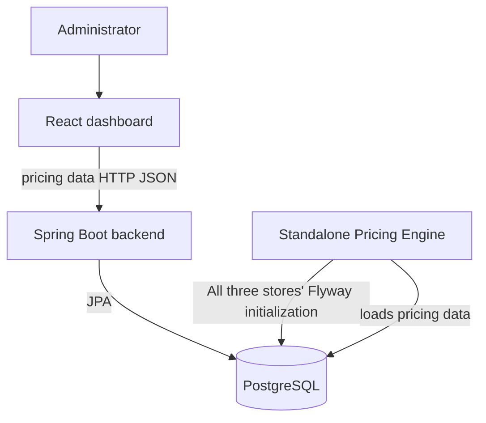

---
aliases:
  - Pricing Project Wiki
  - Project Knowledge Home
status: current
verified: 2026-08-29
tags:
  - agent-wiki
  - home
---

# Project Knowledge Home

This vault explains the implemented Pricing application for agents making features and changes. It connects the domain language to the code paths that enforce it.

> [!important] Sources of truth
> This wiki is a navigation and explanation layer. When it conflicts with an authoritative source, follow the authoritative source: the repository [CONTEXT.md](../../../../CONTEXT.md) for vocabulary, [ADRs](../../../ADR/) for accepted decisions, [openapi.yaml](../../../../pricing-backend/openapi.yaml) for the HTTP contract, migrations and code for implementation, and [Validations.md](../../../Validations.md) for the validation matrix.

## Start with the task

| Task | Read first |
|---|---|
| Learn the business vocabulary | [[01 Domain/CONTEXT]] and [[01 Domain/Concept Relationships]] |
| Understand the running system | [[02 Architecture/System Overview]] |
| Change backend behavior | [[02 Architecture/Backend]] and [[04 Change Guides/Implement a Feature or Change]] |
| Change a dashboard screen | [[02 Architecture/Dashboard]] and [[04 Change Guides/Implement a Feature or Change]] |
| Change an endpoint or payload | [[02 Architecture/API Contract]] |
| Change Pricing Plan data | [[03 Workflows/Configure Pricing]] |
| Change Pricing Batch evaluation | [[03 Workflows/Evaluate a Pricing Batch]] |
| Add or move validation | [[05 Reference/Validation and Integrity]] |
| Work on future distributed processing | [[05 Reference/Current and Planned System]] |

## Fast mental model

The Backend owns pricing data CRUD. The standalone `pricing-engine/` Spring Boot server
owns Pricing Store, Account Store, and Recommendation Store initialization, migrations, evaluation, and
pricing data snapshots.

The Backend synchronous batch endpoint and its engine-dependent wiring have been removed.
On startup or an HTTP wake-up, each engine instance discovers eligible Account Outbox rows and
admits workers up to `ENGINE_MAX_WORKERS` (default `3`). Discovery requires `processed = false`
and SQL `error IS NULL`; even an empty error string excludes a row. `FOR UPDATE SKIP LOCKED`
allows multiple instances to claim different batches. Each worker keeps its Account Store
transaction and row lock open through calculation and the separate local Recommendation Store
commit, then marks its Account Outbox row processed and commits the Account transaction.
Every finishing worker releases its slot and triggers discovery. Admission and overlapping
completion/wake-up discovery are coordinated; wake-ups at capacity are ignored.
After each recommendation commit, the engine sends a payload-free Transaction Processor wake-up
on a virtual thread. Bounded in-memory retries and startup checks of `processed=false` rows follow
the Account Store convention; HTTP delivery leaves the outbox unchanged.
Database/login creation, Flyway migrations, and grants for all three stores finish before HTTP
readiness at `/openapi.yaml`. Startup recovery runs on a virtual thread, checking recommendations
before account draining. Pending processing and unavailable downstream services do not block readiness.
Temporary database failures receive bounded operation retries. A retrying or recovering worker
keeps its slot and pending result/completion state. After exhaustion it periodically checks the
unavailable store; other workers may continue within the instance cap. Recovery stores retained
results unchanged and finishes known pending source completion without recalculation. Connectivity
checks stop after recovery, and healthy idle processing does not poll.
Before evaluation, existing Recommendation Outbox rows identify committed output and allow repair
of the Account Outbox processed flag. Storage retries recognize duplicate batch primary-key errors
without another outbox lookup. Recovery preserves output and Recommendation Outbox state; a restart
reevaluates durable input only when its output never committed.
Unexpected non-temporary evaluation exceptions are logged and persisted in Account Outbox `error`,
leaving the batch unprocessed and excluded across restarts. The worker releases its claim and slot
and triggers discovery; other workers continue. Clearing `error` to SQL `NULL` restores eligibility
on startup, wake-up, or completion. See the evaluation workflow for structured error details.
Unsaved errors retain their worker slot through Account Store recovery. Workers reuse valid claims
or reclaim the same eligible batch after transaction loss, discard errors for competing owners or
ineligible batches, and recover source completion when recommendations already committed.

See [[05 Reference/Current and Planned System]] for implemented and planned behavior.

## Repository map

| Location | Responsibility |
|---|---|
| `pricing-backend/` | Pricing data API, JPA persistence, OpenAPI contract, backend tests |
| `pricing-engine/` | All three stores' initialization and migrations, wake-up API, capped parallel workers, transactional claims, evaluator, pricing data snapshot reads |
| `pricing-dashboard/` | React Router SPA, screens and forms, generated TypeScript client, Playwright tests |
| `docs/ADR/` | Accepted architectural and domain decisions |
| `docs/Validations.md` | Cross-layer validation ownership and expected errors |
| `docs/planned-system-architecture.md` | Design-in-progress for later distributed processing |
| `.scratch/` | Local feature specs and implementation tickets; conventions are in [issue-tracker.md](../../issue-tracker.md) |

## Knowledge graphs

See the [project Graphify instructions](../../../../AGENTS.md#graphify) for query and update commands.
Each application has a graph report for navigating its code and relationships:

- [Backend](../../../../pricing-backend/graphify-out/GRAPH_REPORT.md)
- [Dashboard](../../../../pricing-dashboard/graphify-out/GRAPH_REPORT.md)
- [Mock Server](../../../../pricing-mock-server/graphify-out/GRAPH_REPORT.md)
- [Pricing Engine](../../../../pricing-engine/graphify-out/GRAPH_REPORT.md)

## Reading rule

Use canonical domain terms even when class or field names are shorter. In particular, distinguish a reusable **Fee** definition from a **Pricing Plan Fee**, which is the Fee as configured on one Pricing Plan with its Fee Amount and Eligibility Reasons.

