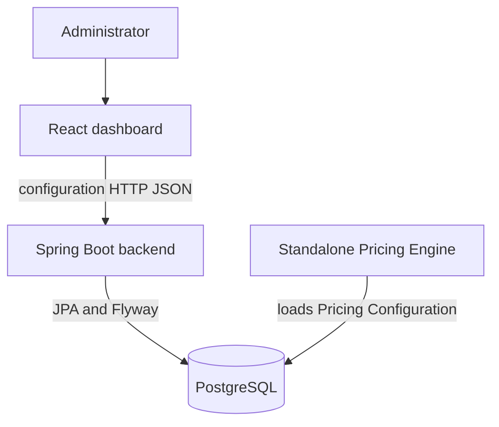

---
aliases:
  - Pricing Project Wiki
  - Project Knowledge Home
status: current
verified: 2026-08-29
tags:
  - agent-wiki
  - home
---

# Project Knowledge Home

This vault explains the implemented Pricing application for agents making features and changes. It connects the domain language to the code paths that enforce it.

> [!important] Sources of truth
> This wiki is a navigation and explanation layer. When it conflicts with an authoritative source, follow the authoritative source: the repository [CONTEXT.md](../../../../CONTEXT.md) for vocabulary, [ADRs](../../../ADR/) for accepted decisions, [openapi.yaml](../../../../pricing-backend/openapi.yaml) for the HTTP contract, migrations and code for implementation, and [Validations.md](../../../Validations.md) for the validation matrix.

## Start with the task

| Task | Read first |
|---|---|
| Learn the business vocabulary | [[01 Domain/CONTEXT]] and [[01 Domain/Concept Relationships]] |
| Understand the running system | [[02 Architecture/System Overview]] |
| Change backend behavior | [[02 Architecture/Backend]] and [[04 Change Guides/Implement a Feature or Change]] |
| Change a dashboard screen | [[02 Architecture/Dashboard]] and [[04 Change Guides/Implement a Feature or Change]] |
| Change an endpoint or payload | [[02 Architecture/API Contract]] |
| Change Pricing Plan configuration | [[03 Workflows/Configure Pricing]] |
| Change Pricing Batch evaluation | [[03 Workflows/Evaluate a Pricing Batch]] |
| Add or move validation | [[05 Reference/Validation and Integrity]] |
| Work on future distributed processing | [[05 Reference/Current and Planned System]] |

## Fast mental model

The Backend owns Pricing Configuration CRUD and schema migrations. The evaluator and configuration
snapshot loader now belong to the standalone `pricing-engine/` Spring Boot server.

The Backend synchronous batch endpoint and its engine-dependent wiring have been removed.
On startup or an HTTP wake-up, the engine discovers pending account batches in the Account Store
and drains discovered sets serially until none remain. It commits relational recommendations and
one outbox row in the Recommendation Store,
then marks the Account Outbox record processed in a separate local transaction.
After each recommendation commit, the engine sends a payload-free Transaction Processor wake-up
on a virtual thread. Bounded in-memory retries and startup checks of `processed=false` rows follow
the Account Store convention; HTTP delivery leaves the outbox unchanged.
Startup recovery runs synchronously after singleton initialization and finishes before the HTTP
listener accepts wake-up calls.
Temporary database failures receive bounded operation retries while the current batch keeps its
turn. After exhaustion, the active worker pauses and periodically checks the unavailable store;
wake-ups are ignored without storage or queuing. Recovery stores retained results unchanged and
finishes any known pending source completion before a fresh Account Outbox scan. Serial processing
and subsequent scans resume; connectivity checks stop and healthy idle processing does not poll.
Before evaluation, existing Recommendation Outbox rows identify committed output and allow repair
of the Account Outbox processed flag. Storage retries recognize duplicate batch primary-key errors
without another outbox lookup. Recovery preserves output and Recommendation Outbox state; a restart
reevaluates durable input only when its output never committed.

See [[05 Reference/Current and Planned System]] for implemented and planned behavior.

## Repository map

| Location | Responsibility |
|---|---|
| `pricing-backend/` | Configuration API, JPA persistence, Flyway migrations, OpenAPI contract, backend tests |
| `pricing-engine/` | Wake-up API, serial batch draining, evaluator, configuration snapshot reads |
| `pricing-dashboard/` | React Router SPA, screens and forms, generated TypeScript client, Playwright tests |
| `docs/ADR/` | Accepted architectural and domain decisions |
| `docs/Validations.md` | Cross-layer validation ownership and expected errors |
| `docs/planned-system-architecture.md` | Design-in-progress for later distributed processing |
| `.scratch/` | Local feature specs and implementation tickets; conventions are in [issue-tracker.md](../../issue-tracker.md) |

## Knowledge graphs

See the [project Graphify instructions](../../../../AGENTS.md#graphify) for query and update commands.
Each application has a graph report for navigating its code and relationships:

- [Backend](../../../../pricing-backend/graphify-out/GRAPH_REPORT.md)
- [Dashboard](../../../../pricing-dashboard/graphify-out/GRAPH_REPORT.md)
- [Mock Server](../../../../pricing-mock-server/graphify-out/GRAPH_REPORT.md)
- [Pricing Engine](../../../../pricing-engine/graphify-out/GRAPH_REPORT.md)

## Reading rule

Use canonical domain terms even when class or field names are shorter. In particular, distinguish a reusable **Fee** definition from a **Pricing Plan Fee**, which is the Fee as configured on one Pricing Plan with its Fee Amount and Eligibility Reasons.

