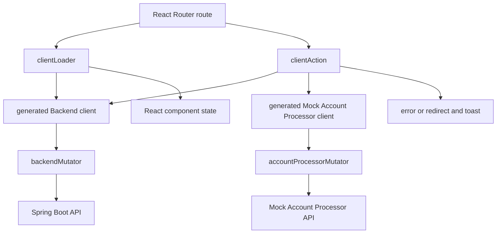

# Dashboard architecture

The dashboard is a React 19 client-side SPA built with React Router 7, TypeScript, Vite, AG Grid, React Select, and React Datepicker. Server-side rendering is disabled in [react-router.config.ts](../../../../pricing-dashboard/react-router.config.ts).

## Routes and screens

Dashboard CI typechecks, runs browser tests, and publishes the production `build/client` artifact.
CD uses the existing AWS OIDC role to upload it and same-origin runtime config to private S3,
waits for CloudFront invalidation, and compares all published bytes through HTTPS. It does not
build a Dashboard image or require ECS. CD discovers the current distribution and bucket from
the `dashboard-s3` origin on every release, including after infrastructure recreation. The Dashboard
README documents publishing permissions. `Publish-Dashboard` in
`deploy/setup.ps1` remains available for manual publishing. Terraform manages the public access block,
Origin Access Control, distribution, and a viewer-request function that rewrites Dashboard routes
to `/index.html`. API paths and assets are not rewritten. Entry/config objects revalidate;
fingerprinted assets cache for one year.
See [ADR 0006](../../../ADR/0006-host-dashboard-on-s3-and-cloudfront.md).
With the ALB enabled, `/api/*` uses the same CloudFront HTTPS hostname and one VPC origin to the
internal ALB. Its existing path rules send `/api/v1/mock/*` to the Mock Account Processor ahead
of the Backend rule. API caching and error caching are disabled; all viewer headers, cookies,
query strings, and request bodies are forwarded. See [ADR 0007](../../../ADR/0007-choose-backend-exposure-architecture.md).
Dashboard ECS hosting, its ECR repository, target group, and task security group are removed.
AWS build/push, status checks, and scaling cover Backend, Mock Processor, and Engine only.
Routine Stop detaches API routing, waits for CloudFront deployment, then deletes the VPC origin
and internal ALB. It retains the distribution's exact HTTPS hostname, bucket and Dashboard files.
Start restores API connectivity on that distribution. Full Destroy also removes CloudFront and
the populated bucket; rebuilding may change the hostname and invalidate distributed URLs.
Dashboard source, generated clients, browser tests, local builds, and Compose remain available.

[routes.ts](../../../../pricing-dashboard/app/routes.ts) defines one shared layout and these screens:

- Branches, Regions, Products, Fees;
- Account Attributes and Eligibility Reasons;
- Pricing Plans, also used as the index route;
- Batch Simulator.

Each pricing data type has a list route and a `:operation/:id?` CRUD route. The shared operations are create, view, update, and delete. List screens use `ListPage`; forms use `CrudPageTopMenu` and feature-specific fields.

## Data flow

[crudRouteUtils.ts](../../../../pricing-dashboard/app/utils/crudRouteUtils.ts) centralizes standard CRUD parameter validation, parallel record/options loading, action dispatch, response-code checks, success redirects, and error extraction. Pages keep editable values in local state through [useFormValues.ts](../../../../pricing-dashboard/app/hooks/useFormValues.ts).

The generated client returns `{ data, status, headers }` for both successful and unsuccessful HTTP responses. [apiMutator.ts](../../../../pricing-dashboard/app/utils/apiMutator.ts) also turns a network failure into a synthetic `503` response, so loaders and actions handle backend and network failures in the same shape.
XML/HTML error bodies use the existing HTTP-status message instead of displaying raw markup.

## Generated client boundary

[orval.config.ts](../../../../pricing-dashboard/orval.config.ts) generates separate clients and models
from each provider-owned contract: `app/generated/backend/` for the Backend and
`app/generated/accountProcessor/` for the Mock Account Processor. Both are derived output and are
cleaned before generation. `BACKEND_API_URL` and `ACCOUNT_PROCESSOR_API_URL` independently select
browser-visible provider addresses in native development and Docker runtime configuration.
Unset production addresses retain AWS same-origin routing.

## Form conventions

The dashboard combines several kinds of prevention:

- native input constraints for required values, lengths, patterns, minimums, and types;
- disabled controls when a record or relationship cannot currently be changed;
- option filtering by Product Applicability;
- editable list controls that prevent a second incomplete child row;
- backend error display when the API remains authoritative.

The form state is intentionally feature-local rather than stored in a global state library.

## Pricing Plan special case

[pricingPlans/crud.tsx](../../../../pricing-dashboard/app/routes/pricingPlans/crud.tsx) first loads primary options. Once Product and Region both exist, it fetches [[01 Domain/CONTEXT#Secondary Pricing Plan Options|Secondary Pricing Plan Options]]. The response is accepted only if its echoed Product and Region IDs still match the current selection, preventing a slow earlier request from overwriting newer context.

Secondary options drive:

- Product-applicable Fees and Eligibility Reasons;
- unavailable active periods for the Product and Region;
- the application current date;
- whether the active-period and Pricing Plan Fee controls are enabled.

The page mirrors lifecycle mutability in its disabled fields, while the backend remains authoritative. [PricingPlanFeeEditor.tsx](../../../../pricing-dashboard/app/routes/pricingPlans/PricingPlanFeeEditor.tsx) prevents duplicate Fees and prevents adding another row while an [[01 Domain/CONTEXT#Incomplete Pricing Plan Fee|Incomplete Pricing Plan Fee]] exists.

## Simulator special case

[simulator/index.tsx](../../../../pricing-dashboard/app/routes/simulator/index.tsx) maintains account
and Fee Request drafts in local state. Product selection filters Account Attributes and Fees by
Product Applicability. Every account and Fee Request receives a stable client-side identifier.
`Send` assigns a batch UUID when needed and posts the Pricing Batch through the Mock Account Processor
client and a React Router fetcher without navigation. Each account retains its `pricingDate`.
Pricing data, Simulator options, and Application Date operations continue using the Backend.

`Send` immediately becomes `Reset`, disabled while submission is pending. HTTP 202 displays the
accepted `batchId` and `message`; the Simulator remains locked until `Reset`, which clears the
acknowledgement and current batch UUID while preserving the drafts. The next submission receives a
new UUID. HTTP and transport failures, including timeouts, restore `Send` and editability; retries
reuse the submitted batch UUID even after draft corrections. `BATCH_ALREADY_ACCEPTED` HTTP 409
displays the provider's error and retains `Reset` and locking without creating an acknowledgement.
No completed pricing results or WebSocket connection are used.

## Browser tests

Playwright tests under [e2e](../../../../pricing-dashboard/e2e/) intercept provider requests. They
verify form behavior, Product Applicability, Pricing Batch composition, independent provider
addresses, acceptance, pending and accepted locking, Reset, and existing error recovery. Add
coverage to the feature spec that owns the changed behavior.

