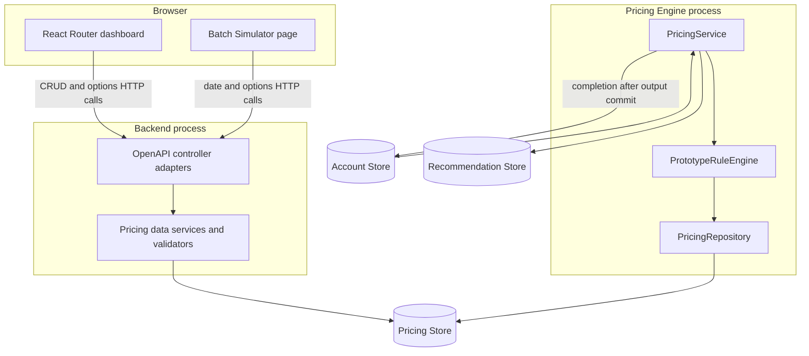

# System overview

## Implemented runtime

The standalone `pricing-engine/` server owns evaluation and discovery of pending accounts on
startup and HTTP wake-ups, plus initialization and migrations for all three stores.
Backend pricing data CRUD remains in `pricing-backend/`; its synchronous batch endpoint has
been removed. The engine reads the Account
Store, commits relational recommendations and their outbox in the Recommendation Store, then marks
source completion separately. Shared privileged credentials initialize databases, logins, migrations,
and grants before HTTP readiness at `/openapi.yaml`; runtime connections use restricted logins.
Startup recovery and pending account processing run on a virtual thread, so pending work and
unavailable downstream services do not delay readiness.



The backend owns pricing data writes. Flyway creates and evolves the schema; Hibernate validates the mappings rather than creating tables. The dashboard consumes the backend's OpenAPI contract through generated TypeScript code.

## Two major capabilities

### Pricing data

CRUD endpoints manage:

- Branches and Regions for geographic resolution;
- Products and their Product Types;
- reusable Fees and Account Attributes with Product Applicability;
- Eligibility Reasons composed of typed Account Attribute conditions;
- Pricing Plans and their Pricing Plan Fees.

The standard request flow is:

```text
dashboard route loader/action
  -> generated TypeScript client
  -> generated Java API interface implemented by a controller
  -> service and validator
  -> mapper and Spring Data repository
  -> PostgreSQL
```

### Pricing evaluation

The simulator submits account records to the Mock Account Processor, which persists them and
returns HTTP 202. Startup and payload-free `POST /api/v1/work-available` requests share one serial
run in `PricingService`. `PricingController` acknowledges wake-ups with an empty HTTP 202 response.
The run discovers Account Outbox rows, processes each batch through the existing evaluator, and
scans again until no work remains. Recommendations and their outbox commit before source
completion. See [[03 Workflows/Evaluate a Pricing Batch]].

## The two dates

| Date | Owner | Purpose |
|---|---|---|
| Application current date | `SimulatorService` in-memory application clock | Controls Pricing Plan lifecycle mutability and the dates disabled in Pricing Plan forms |
| Pricing Date | Each account in a Pricing Batch | Selects the Pricing Plan used to evaluate that account |

The simulator normally copies its application date into every drafted account's Pricing Date when it submits a batch. The Pricing Engine itself evaluates the submitted Pricing Date and does not read the simulator clock.

## Pricing data snapshot boundary

For one Pricing Engine invocation, [PricingRepository.java](../../../../pricing-engine/src/main/java/com/pricing/engine/pricingStore/PricingRepository.java) loads one immutable `Pricing`:

- every Branch and Region membership;
- only Pricing Plans active on at least one distinct submitted Pricing Date;
- the selected plans' Fees, Eligibility Reasons, conditions, and Account Attribute definitions.

The phased reads run in a read-only `REPEATABLE_READ` transaction. Evaluation begins after the snapshot is mapped into engine-owned immutable records. This boundary implements [ADR 0004](../../../ADR/0004-choose-pricing-engine-evaluation-location.md).

## What is outside the current runtime

The Transaction Processor remains future work. The engine's interrupted-completion recovery
preserves committed recommendations and repairs the Account Outbox processed flag. Startup
reevaluates batches whose output never committed. See [[05 Reference/Current and Planned System]].

## Primary implementation entry points

- Backend boot: [BackendApplication.java](../../../../pricing-backend/src/main/java/com/pricing/backend/BackendApplication.java)
- Contract: [openapi.yaml](../../../../pricing-backend/openapi.yaml)
- Pricing orchestration: [PricingService.java](../../../../pricing-engine/src/main/java/com/pricing/engine/PricingService.java)
- Pricing Engine: [PrototypeRuleEngine.java](../../../../pricing-engine/src/main/java/com/pricing/engine/PrototypeRuleEngine.java)
- Dashboard routes: [routes.ts](../../../../pricing-dashboard/app/routes.ts)
- Simulator screen: [simulator/index.tsx](../../../../pricing-dashboard/app/routes/simulator/index.tsx)

