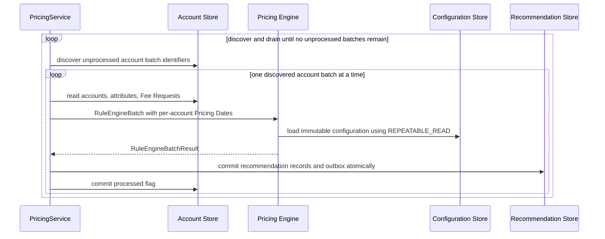

# Evaluate a Pricing Batch

The standalone Pricing Engine discovers pending account records on startup and HTTP wake-ups.
`PricingController` accepts payload-free `POST /api/v1/work-available` requests with an empty
HTTP 202 response. This acknowledges the wake-up without confirming completed pricing.
The Backend owns configuration CRUD and no longer exposes a synchronous batch endpoint.



## 1. Read accepted account records

The Mock Account Processor validates and atomically accepts submissions into the Account Store.
`AccountRepository` loads the account records, their individual Pricing Dates, scalar Account
Attributes, and Fee Requests in a read-only JPA transaction. `AccountMapper` produces the existing
engine-owned input before that transaction closes. There is no batch-level Pricing Date.
## 2. Load one configuration snapshot

The Pricing Engine collects distinct Pricing Dates and asks `PriceConfigRepository` for one configuration. The JPA adapter loads all Branches and Regions but only Pricing Plans active on at least one submitted Pricing Date, plus their complete Fee and Eligibility Reason graph.

If configuration access fails, evaluation throws `PricingAccessException`. Temporary database
failures retry the failed operation with bounded attempts and delay. Configuration access retries
finish before calculation begins; storage retries keep the completed result unchanged and do not
reload configuration. The current batch keeps its turn during delays. Startup recovery runs after
singleton initialization and completes before the HTTP listener accepts wake-up calls.
Expected account and Fee Request validation outcomes do not trigger infrastructure retries.

Recommendation writes and their outbox row remain one local transaction on every attempt. After
successful persistence, downstream notification starts before source completion. Retry exhaustion
pauses the active worker with unfinished input unprocessed and no durable failed state. It checks
the unavailable store's connectivity periodically and ignores wake-ups without storing or queuing
them. Once access returns, it stores retained results unchanged and finishes any known pending
source completion before a fresh Account Outbox scan. Normal serial processing and subsequent
scans resume, and connectivity checks stop. Healthy idle processing does not poll.

## 3. Resolve each account

Accounts are evaluated independently against the same immutable configuration.

### Resolve the Branch

Branch code lookup is exact. A miss returns `BRANCH_NOT_FOUND` for that account.

### Resolve the Region

The engine checks Region tiers in priority order:

1. exact Branch membership;
2. ZIP code membership;
3. state membership.

It stops at the first tier containing a match. No match returns `REGION_NOT_FOUND`; multiple matches in the winning tier return `ERROR`.

### Select the Pricing Plan

A match requires exact Product code, exact resolved Region code, and an inclusive active period:

```text
activeFrom <= Pricing Date <= activeThrough
```

No match returns `PLAN_NOT_FOUND`; multiple matches return `ERROR`.

### Validate required Account Attributes

The engine derives requirements only from Eligibility Reason conditions attached to requested Pricing Plan Fees. An Account Attribute used only by an unrequested Fee is not required.

For required codes:

- a repeated value returns `DUPLICATE_ATTRIBUTE`;
- a value whose runtime representation does not match its configured type returns `INVALID_ATTRIBUTE_TYPE`;
- an absent value returns `MISSING_ATTRIBUTE`.

An account-level failure omits its Pricing Plan code and Fee results. Other accounts continue.

## 4. Evaluate each Fee Request

For each Fee Request:

1. Find the Pricing Plan Fee by exact Fee code. A miss returns `FEE_NOT_FOUND`.
2. For a percentage Fee, require a transaction amount. Absence returns `MISSING_TRANSACTION`; at the engine boundary, a negative value or more than two decimal places returns `INVALID_TRANSACTION_AMOUNT`.
3. Validate persisted Eligibility Reason operator/type combinations and values. Invalid configuration returns `INVALID_ELIGIBILITY_CONDITION` for that Fee Request.
4. Evaluate every attached Eligibility Reason. Conditions inside one reason use AND; reasons attached to the Pricing Plan Fee use OR.
5. If any reason is satisfied, return a **waived** Pricing Decision with every satisfied Eligibility Reason code.
6. Otherwise return a **charged** Pricing Decision.

Fee failures are isolated to that Fee Request. Other Fee Requests and accounts continue.

The Mock Account Processor rejects a supplied transaction amount that is not an increment of `0.01` before evaluation, so an HTTP caller normally receives `400` for excess decimal precision. The engine's `INVALID_TRANSACTION_AMOUNT` status remains defense at the engine boundary and is relevant to direct or future persisted-batch callers.

## 5. Calculate the charged amount

| Fee type | Calculation |
|---|---|
| Flat | Fee Amount |
| Percentage | `transactionAmount * Fee Amount / 100` |

The charged amount is rounded to two decimal places with `HALF_UP`. A conditionless Eligibility Reason is satisfied, so attaching one makes the Pricing Plan Fee unconditionally waived after transaction validation.

## 6. Correlate the result

The recommendation batch retains the input `batchId`. Accounts are correlated by Account Number; Fee results are correlated by Fee Request ID. Result order is not a contract.

Successful Fee Requests have status `OK` and exactly one Pricing Decision shape:

- `CHARGED` with `amount` and no Eligibility Reasons;
- `WAIVED` with satisfied Eligibility Reason codes and no amount.

The enum definitions are in [RuleEngineBatchResult.java](../../../../pricing-engine/src/main/java/com/pricing/engine/RuleEngineBatchResult.java), and executable examples are in [PrototypeRuleEngineTests.java](../../../../pricing-engine/src/test/java/com/pricing/engine/PrototypeRuleEngineTests.java) and [PricingPersistencePostgresTests.java](../../../../pricing-engine/src/test/java/com/pricing/engine/PricingPersistencePostgresTests.java).

## 7. Persist recommendations and complete the source

`RecommendationMapper` maps account and Fee Request outcomes into relational JPA entities.
`RecommendationRepository.save` uses one local transaction to persist `recommendation_batches`,
`account_recommendations`, `fee_request_recommendations`, satisfied Eligibility Reason codes in
`recommendation_eligibility_reasons`, and `recommendation_outbox`. The outbox batch identifier is
its primary key and references the recommendation batch. Recommendation records do not use JSONB.

After that transaction commits, `AccountRepository.markProcessed` updates the Account Outbox in
its own transaction. No transaction spans the stores. An output write failure rolls back the
entire output; a source-completion failure leaves the committed recommendations intact.

Startup and wake-ups share one serial run. Each discovered set is followed by another scan;
wake-ups received during processing are discarded. The final scan and transition to idle share
the wake-up lock, so newly committed work cannot be stranded by an overlapping wake-up.
The healthy idle engine does not poll the outbox, and batches have no global FIFO requirement.
Before loading or evaluating an unprocessed batch, the engine checks for its Recommendation Outbox
row, including rows already marked processed. If it exists, the engine preserves the recommendations
and Recommendation Outbox state and sets the Account Outbox processed flag in its own transaction.

If a commit acknowledgement is lost, the engine retries storage of the retained result. A unique
violation on the recommendation batch or outbox primary key identifies committed output and
allows the Account Outbox update to finish, without another outbox lookup during storage.
Other integrity failures still propagate. No configuration is reloaded for retained results.
A restart reevaluates durable account input when its output never committed; no separate durable
calculation cache is stored.
