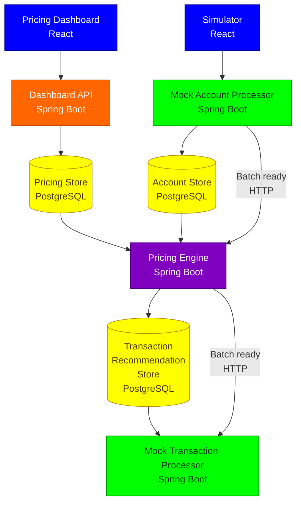
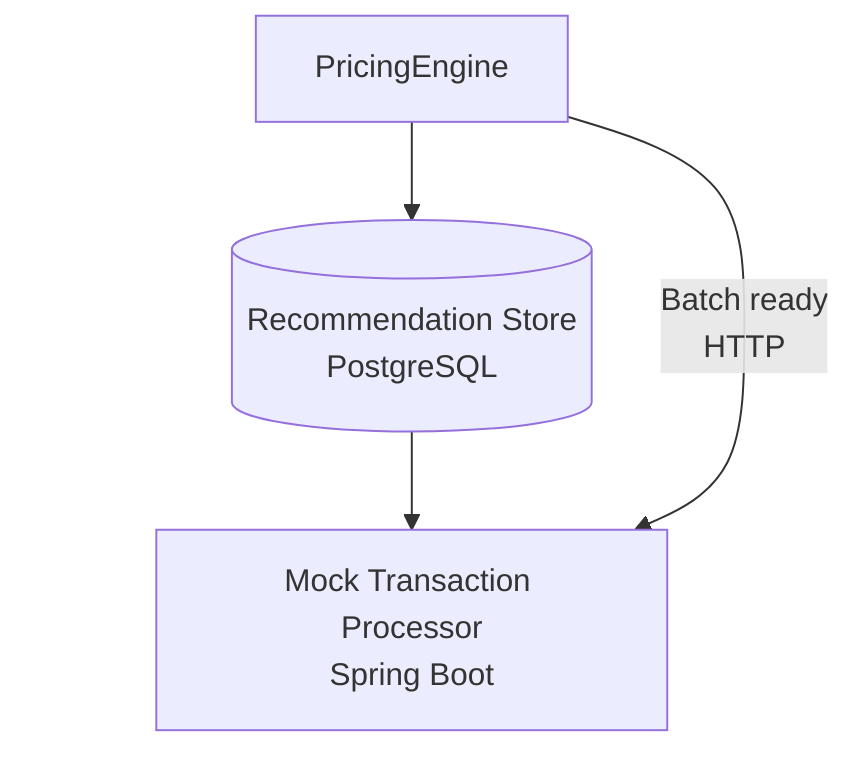

# Planned Architecture

Status: partially implemented; follow-on asynchronous behavior remains planned

## 1. Project purpose

This is a portfolio project intended to demonstrate engineering skills
beyond ordinary CRUD/full-stack feature development: system design,
domain modeling, distributed processing, failure handling, deployment,
observability, and architectural decision-making.

A substantial **Dashboard + Spring Boot backend + PostgreSQL
Pricing Store** already exists. It manages pricing data such as Pricing Plans and Pricing Plan Fees,
Eligibility Reasons and Conditions, Account Attributes, Products, and Regions.

The project has already consumed substantial development time, so future
work should favor **new architectural capabilities over additional
dashboard convenience features**.

## 2. High-level planned system

Conceptually:



The Pricing Engine reads pricing data from PostgreSQL while
processing persisted account batches.

The Account Processor and Transaction Processor are outside the pricing
system. Both are mocked by the simulator/test environment, but their
boundaries should behave as if they were independent external systems.

## 3. Dashboard / pricing data - IMPLEMENTED

The dashboard manages pricing data used by the Pricing Engine:

-   Products
-   Pricing Plans
-   Fees
-   Eligibility Reasons
-   Conditions
-   Account Attributes
-   Regions/geographic applicability
-   Effective date ranges

PostgreSQL is appropriate here because the pricing data has
substantial relational structure.

### Pricing Plan lifecycle - IMPLEMENTED

Current design uses a **date-based lifecycle**:

**Scheduled → Active → Past**

The application's current/business date determines the stage.

Current proposed mutability:

-   **Scheduled:** fully mutable.
-   **Active:** only Plan Name and Active Through can change.
-   **Past:** only Plan Name can change.

The objective is **historical pricing integrity**: pricing data changes
today must not silently alter what an effective/historical pricing plan
meant previously.

The backend already restricts updates to Fees, Eligibility Reasons and
Account Attributes when those changes would indirectly modify
active/past pricing plans.

This is **important domain correctness**, not mere UI polish.

## 4. Dashboard scope

Finish work necessary for historical integrity, lifecycle correctness,
important backend validation, preventing invalid pricing data, and
correctness of relationships.

Avoid substantial additional time on convenience features, sophisticated
form behavior, prettier abstractions, unnecessary refactoring, or
elaborate frontend prevention of errors already safely rejected by the
backend.

The next major value comes from the **pricing engine and distributed
processing architecture**.

## 5. Simulator - FIRST ITERATION IMPLEMENTED

The simulator is a testing tool that tests the pricing system.
It will send a request to mock Account Processor and receive report
about transaction recommendations from mock Transaction Processor.

On the upstream side, the Mock Account Processor:

-   accepts or constructs account information/scenarios;
-   processes and stores the account batch;
-   notifies the Pricing Engine that the persisted account batch is ready
    for processing.

The Pricing Engine then processes the persisted account batch rather than
receiving the full batch as a transient notification payload.

On the downstream side, the Mock Transaction
Processor can consume persisted transaction recommendations after being
notified that a recommendation batch is ready.

Mock Account Processor and Mock Transaction processor will be located on Mock Server.
A Spring Boot server dedicated to house these two services.

The Mock Server uses the shared `/api/v1/mock/*` routing prefix:

- `POST /api/v1/mock/acc/batch`: submit an account batch to the Mock Account Processor.
- `POST /api/v1/mock/txn/wake`: planned wake-up endpoint for the Mock Transaction Processor.

The Transaction Processor wake-up carries no `batchId`; it signals the processor to query
PostgreSQL for pending recommendations. No Transaction Processor batch-submission endpoint is
currently planned.

When the Mock Server is exposed through the ALB, route `/api/v1/mock/*` to it before the
existing `/api/*` backend rule. The synchronous backend keeps `/api/v1/batch`.

In first iteration, the simulator sends an HTTP request directly to the pricing 
engine located in Pricing API back end server and receives an HTTP response with
transaction recommendations.

## 6. Pricing Engine

### Relocation implementation status

Ticket 01 provides the standalone `pricing-engine/` Spring Boot server, the relocated evaluator,
and the immutable pricing data snapshot loader. Pricing data CRUD and Pricing Store migrations remain
in `pricing-backend/`; the engine validates that existing schema without applying migrations.
Its pricing data-read mappings do not depend on the Backend executable.

Ticket 02 removes the Backend synchronous batch endpoint and adds startup processing. `PricingService` discovers unprocessed Account Outbox rows and processes the discovered set serially. JPA repositories read accounts with per-account Pricing Dates and map existing evaluator output into relational recommendation records. The recommendation batch, account outcomes, Fee Request outcomes, satisfied Eligibility Reasons, and uniquely keyed Recommendation Outbox row commit in one local transaction. A separate Account Store transaction marks source completion afterward. Recommendation migrations belong to the engine; Pricing Store and Account Store migrations retain their existing owners.

Ticket 03 adds `POST /api/v1/work-available`, owned by the engine's OpenAPI contract.
The payload-free request returns an empty HTTP 202 acknowledgement; it does not confirm completed
pricing. `PricingController` delegates to `PricingService`, which shares one serial run between
startup and wake-ups. After each discovered set, the run scans again until no work remains.
Wake-ups during processing are discarded. Discovery and the transition to idle use the same lock
as incoming wake-ups, so a notification overlapping the final empty scan starts a new run after
that scan. There is no pending-wake-up queue or flag, healthy idle polling, or global FIFO order.

### Asynchronous processing and recovery

The Pricing Engine runs as its own Spring Boot server and processes batches
asynchronously.

The asynchronous Pricing Engine preserves the existing pricing evaluation rules.

The first asynchronous version runs a single Pricing Engine instance and processes
Pricing Batches one at a time, in series. Independent Pricing Batches may complete
out of submission order.

After processing the batches returned by an outbox scan, the engine scans the
outbox again for any new unprocessed batches that arrived during processing.
If it finds more batches, it processes them in series and checks again after
finishing them.

Pricing data is captured when evaluation starts, rather than when the
Account Processor accepts the batch. Temporary infrastructure failures receive
bounded automatic retries with delay. After retries are exhausted, the batch
remains unprocessed.

The engine waits and retries the same batch. It does not start another Pricing
Batch to fill that batch's retry delay.

If calculation has completed but storing its results fails, the engine retains
the already-calculated results. When database connectivity returns, it retries
storing those same results. It does not discard them or recalculate the batch.

If retries are exhausted because a required database is unavailable, the engine
stops batch processing until database connectivity is restored. It does not
attempt the remaining batches against the unavailable database; they remain
unprocessed.

After database retries are exhausted, the engine periodically checks database
connectivity while the database is unavailable. During this time, it does not
start new batch processing and ignores incoming wake-up calls without storing,
queuing, or remembering them. When connectivity is restored, the engine first
stores any already-calculated results awaiting persistence, then performs a
one-time outbox scan for all unprocessed Pricing Batches and processes them one
at a time, in series.

The Account Processor persists an account batch in PostgreSQL, then sends an HTTP
notification to the Pricing Engine indicating that new account work may be available.
The HTTP notification is a wake-up signal; PostgreSQL is the durable source of pending
work, and the Pricing Engine queries it for unprocessed batches.

The Pricing Engine reads and processes pending account batches, applies pricing data,
and persists the resulting transaction recommendations in PostgreSQL. After recommendation
records are persisted, it sends an HTTP notification to the Transaction Processor indicating
that new recommendation work may be available. The Transaction Processor then queries the
recommendation store for unprocessed work.

On startup or restart, each consuming service checks PostgreSQL for unprocessed batches so
recovery does not depend on preserving notification messages while the service is down.

`batchId` remains the correlation identifier for persisted account batches and the resulting
transaction recommendations. The HTTP wake-up notification does **not** include `batchId`; its
only purpose is to tell the receiving service to check PostgreSQL for unprocessed work.

## 7. Recommendation vs transaction processing

The Pricing Engine should **not simply hand transaction recommendations
directly to the Transaction Processor as transient messages**.

Instead:



Reasons:

-   recommendations survive downstream outages;
-   calculation can be audited separately from posting;
-   posting failures do not require recalculating pricing;
-   failed batches can be inspected/retried;
-   pricing calculation and transaction posting remain separate
    responsibilities;
-   original calculated recommendations can be preserved.

A transaction recommendation is data, not a separate architectural
service.

## 8. Recommendation store: POSTGRESQL

Transaction recommendations will be stored in **PostgreSQL**.

The recommendation store is separate in purpose from the Pricing Store
data, even if both use PostgreSQL. Recommendation data is generated by the
Pricing Engine and is expected to be primarily append-oriented / immutable after
calculation.

Using PostgreSQL allows the recommendation batch, its recommendation records,
and the corresponding outbox row to be persisted atomically in one database
transaction.

The Transaction Processor can read recommendations from that PostgreSQL store.

The important point is an intentional recommendation data contract rather than
the Transaction Processor arbitrarily depending on unrelated internal Pricing
Engine persistence structures.

## 9. Batch-ready notifications

There are two notification boundaries:

1.  **Account Processor → Pricing Engine:** new account work may be available.
2.  **Pricing Engine → Transaction Processor:** new recommendation work may be available.

The notification is a **wake-up signal**, not the durable representation of work. The
business records are persisted in PostgreSQL before notification, and the consumer queries
the relevant PostgreSQL store for unprocessed batches.

Consumers also query PostgreSQL for unprocessed batches when they start or restart. Work
therefore remains discoverable even when a consumer was unavailable when the notification
was originally attempted.

## 10. Notification transport: HTTP

The producing service calls an endpoint on the downstream service after persisting new work.
The receiving service uses the request as a signal to check PostgreSQL for unprocessed batches;
it does not receive the batch records in the notification payload.

HTTP is intentionally used as a lightweight notification mechanism rather than as the durable
work queue. PostgreSQL holds the durable processing state and is the source from which pending
work is recovered.

### HTTP wake-up contract

The HTTP wake-up notification does **not** include `batchId`. It is a generic signal that new
work may be available. The receiving service responds by querying PostgreSQL for unprocessed
batches.

The Pricing Engine receives `POST /api/v1/work-available` on port 8082 by default, matching the
Account Processor's configured notification URL. It returns HTTP 202 with no response body after
accepting the wake-up, without waiting for pricing or recommendation persistence to finish.
The provider-owned contract is `pricing-engine/openapi.yaml`.

ADR 0005: **Use HTTP wake-up notifications with PostgreSQL-backed pending-work recovery**.

### Wake-up URL deployment configuration (proposed)

For AWS, Terraform would construct each full wake-up URL from the shared ALB base address
and the downstream endpoint path. It would supply the URL through the container `environment`
configuration in the producing service's ECS task definition:

- Account Processor: `PRICING_ENGINE_WAKE_UP_URL`.
- Pricing Engine: `TRANSACTION_PROCESSOR_WAKE_UP_URL`.

Spring reads these variables through the placeholders in `application.properties`. The URLs
are supplied when containers start, so images need no environment-specific URL configuration
at build time and deployments need no manual URL entry.

The dashboard uses a different mechanism in AWS: its relative API paths are resolved by the
browser against the dashboard page's address. Server-side wake-up clients require an explicitly
configured destination.

## 11. Transactional outbox

Persisted work-available notifications use an **outbox stored in the
producer-owned PostgreSQL database**.

The outbox is not an append-only event history. There is exactly **one outbox
row per batch**, and `batchId` is the primary key of that row.

The Batch Outbox schema and delivery lifecycle are specified in the
[Mock Account Processor design](mock-account-processor-design.md).

The Recommendation Outbox follows the Account Store convention: one row per batch with
`batch_id` and `processed`, initially `false`. It stores no notification-delivery state.
Successful HTTP delivery leaves the row unchanged. The consumer marks processing completion.

The producer's durable business result and the corresponding outbox row are
written atomically in the same local PostgreSQL transaction.

For Pricing Engine output, the transaction contains:

-   the recommendation batch and its recommendation records; and
-   the recommendation outbox row keyed by the same `batchId`.

This atomic transaction is local to the Recommendation Store. The architecture
does **not** require the Account Store and Recommendation Store to remain in the
same physical database.

## 12. Outbox wake-up ownership and recovery

The same service that persists a batch/result owns the outbox row for that
batch and is responsible for sending its wake-up notification.

Normal operation:

-   the service stores its durable batch/result and the one outbox row for that
    `batchId` atomically;
-   after persistence commits, the service starts an asynchronous HTTP wake-up
    without waiting for source completion;
-   HTTP delivery retries in memory with configured attempt limits, delays, and timeouts;
-   acknowledgement or retry exhaustion leaves the durable output and outbox unchanged.

Account Processor wake-up retries and startup recovery are specified in the
[Mock Account Processor design](mock-account-processor-design.md).

For the Pricing Engine's Recommendation Outbox, recovery behavior:

-   before draining account batches on startup, it checks for Recommendation Outbox
    rows with `processed=false` and starts a generic wake-up when any exist;
-   the same bounded HTTP retries apply to startup wake-ups;
-   as a consumer it processes any ready batches;
-   continuous database polling solely for crash recovery is not part of the
    current design.

The Pricing Engine may successfully send a wake-up and restart while its recommendations
are still unprocessed. Startup can therefore send another wake-up for the same durable work.
This is expected and harmless because the notification contains no
business payload; it only tells the consumer to query PostgreSQL for pending
work.

## 13. Duplicate delivery / idempotency

Duplicate HTTP wake-up notifications are possible and must be tolerated.

Pricing-batch idempotency is based on the **one-outbox-row-per-batch invariant**:

-   `batchId` is the primary key of the outbox;
-   recommendation persistence and insertion of that outbox row happen in the
    same Recommendation Store transaction;
-   a second attempt to complete the same Pricing Batch cannot insert another
    outbox row with that `batchId`;
-   therefore a retry or concurrent Pricing Engine instance cannot commit a
    second set of recommendations for the same batch. The conflicting
    transaction is rejected/rolled back and the already-existing outbox row
    proves that the recommendation result for that `batchId` was previously
    committed.

This keeps the design scalable if the Account Store and Recommendation Store
are later separated into different databases.

In that future topology, updating the source Account Batch status and writing
the Recommendation Batch cannot be one local transaction. A failure can
therefore leave the Account Store temporarily showing a batch as ready even
though its recommendations were already committed.

If the Pricing Engine encounters that batch again, the existing outbox row with
the same `batchId` identifies it as already completed. The Pricing Engine must
not generate another committed recommendation result; it can instead repair the
source-batch status.

Before evaluating an unprocessed Account Batch, the engine checks for its Recommendation
Outbox row, regardless of that row's `processed` value. Existing output is preserved and the
Account Outbox's `processed` flag is set to `true` in its own local transaction.

If a recommendation commit acknowledgement is lost, storage retries the retained result.
A PostgreSQL unique violation on the recommendation batch or outbox primary key identifies
already-committed output. The engine then completes the Account Outbox update without checking
the outbox again during storage or changing the Recommendation Outbox's processing state.
Other database constraint errors still fail. Notification starts after successful storage or
recognition of the committed result, independently of the Account Outbox update.

A restart loses calculations that never committed. Startup evaluates those batches again from
durable account input; it adds no durable calculation cache. Committed output is recognized
before evaluation, so changed pricing data cannot replace it during recovery.

The same uniqueness rule also protects against two Pricing Engine instances
attempting to complete the same batch concurrently: only one transaction can
successfully insert the outbox row for that `batchId`.

The **Transaction Processor is outside the pricing-system boundary**. The
pricing system prices fees and produces transaction recommendations; it does
not post financial transactions to accounts. Transaction-posting idempotency is
therefore the responsibility of the external Transaction Processor, not this
system. The simulator uses a Mock Transaction Processor only to exercise that
external boundary and return/display recommendation results.

## 14. Documentation

Architecture documentation should have two levels.

### Main design documentation

Answers: **How does the system work?**

Include architecture diagram, component responsibilities, data flows,
storage ownership, sync/async communication, and major processing flows.

### ADRs

Answer: **Why did we choose X rather than reasonable alternative Y?**

Each ADR should be a separate small Markdown file:

``` text
docs/
  architecture/
    architecture.md
    adr/
      001-pricing-plan-lifecycle.md
      002-...
```

Typical ADR:

``` text
# Title

## Status
## Context
## Options Considered
## Decision
## Rationale
## Consequences
```

Good ADR candidates:

-   Pricing Plan lifecycle, mutability, and effects on referenced
    pricing data
-   PostgreSQL recommendation persistence strategy
-   HTTP wake-up notifications with PostgreSQL-backed pending-work recovery
-   Transactional outbox and application-owned publishing/restart recovery
-   Pricing-batch idempotency and duplicate-safe recommendation persistence

Do not create ADRs merely to increase the count. Rough target: **5
strong ADRs**, perhaps 6--8 if genuinely important decisions emerge.

## 15. Immediate next steps

1.  Finish current dashboard lifecycle/integrity work.
2.  **Freeze dashboard scope.**
3.  Create lightweight overall system architecture.
4.  Finalize recommendation-store schema and ownership/data flow in PostgreSQL.
5.  Design Pricing Engine contract-first.
6.  Implement Pricing Engine.  <-- **we are here. Prototype engine implemented. Time to deploy slice**
7.  Implement batch/account processing.
8.  Implement persisted recommendations + downstream processing.
9.  Finalize the HTTP endpoint/request-response shape and design the remaining
    batch-processing idempotency details. The notification transport, absence of `batchId` in
    the wake-up signal, outbox reliability, publisher ownership, and startup recovery behavior
    are already decided.
10. Deploy.
11. Add structured logging, metrics, health checks and monitoring.
12. Finish architecture documentation/ADRs.

## Guiding principle

> **Do not add complexity merely to make the architecture look
> sophisticated. Every additional component---including Kafka, Lambda, CDC,
> or an outbox---needs a concrete responsibility and a
> defensible tradeoff.**

The next phase is intended to demonstrate **system-design judgment**,
not the ability to accumulate infrastructure services.
